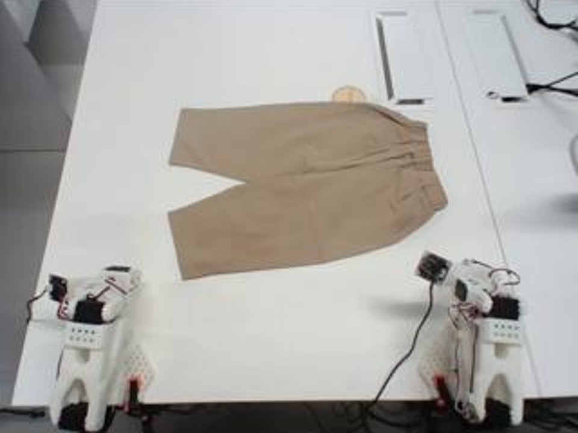
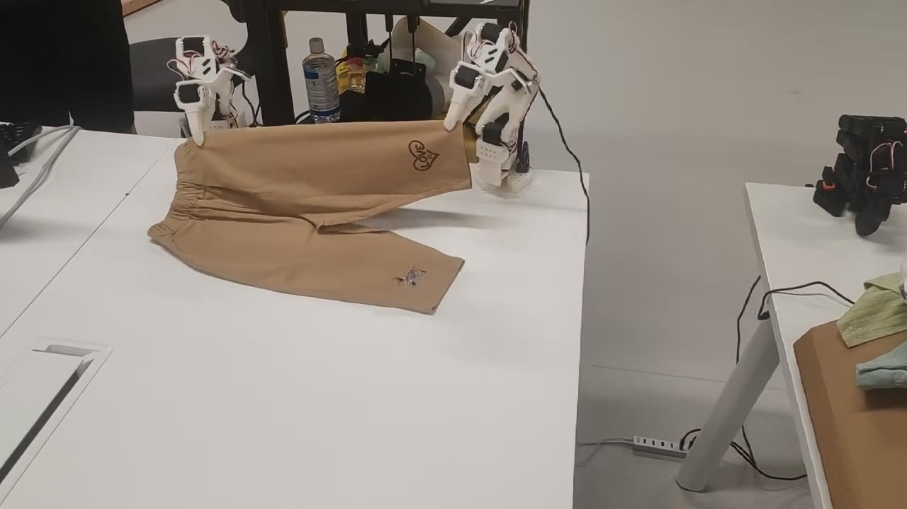
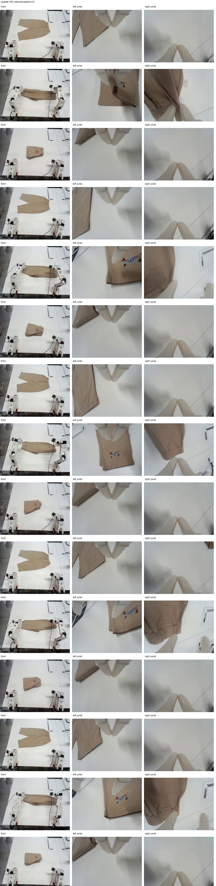

# SO101-PI05：π₀.₅ 双臂叠裤子

基于 LiOS / π₀.₅ 的三相机双臂 SO101 训练与真机推理项目。这个发布包只提供 **冻结 PaliGemma 主干、训练动作专家及相关投影层的本地 step100000 模型**，不包含云端全参数模型。



> 图片来自实际工作区/相机历史记录，不代表本模型的独立成功率评测。叠裤子演示见下方；演示视频不代表独立成功率评测。

## 成功演示视频

[](https://github.com/Morantkk/SO101-PI05/raw/refs/heads/main/media/videos/success_demo_h264.mp4)

[观看 / 下载叠裤子演示视频](https://github.com/Morantkk/SO101-PI05/raw/refs/heads/main/media/videos/success_demo_h264.mp4) · [视频说明](media/videos/README.md)

录制时的检查点、RTC 模式、播放速度和人工介入情况未记录；未提供成功率统计。

## 已完成的工作

- 三路相机：正面、左腕、右腕；RGB 224×224。
- LeRobot v3 数据读取、左右腕映射核对、首尾静止段裁剪、数据划分与归一化来源校验。
- 冻结视觉语言主干训练动作专家；保留训练配置、指标曲线和检查点来源。
- 原生 LiOS Pixi 推理、WebRTC 图传、CUDA IPC 图像缓冲及 WebSocket 动作/状态通道。
- 普通 40 步去噪推理，以及 RTC 动作块重叠引导与异步队列衔接。
- 统一命令：启动、停止、半开夹爪后归位、清缓存、状态查询、模型注册和离线检查。
- 停止推理时关闭相机 sender 和 receiver，释放设备；再次启动重建连接，避免旧帧残留。
- 归位：夹爪到标定开度 50%，到位后等 **0.5 秒**，再恢复记录的完整归位姿态。

## 唯一发布模型

| 项目 | 内容 |
|---|---|
| CLI 名称 | local100000 |
| 基础模型 | LeRobot π₀.₅，冻结 PaliGemma 主干 |
| 训练部分 | 动作专家及未冻结的相关投影层；不是全参数微调 |
| Batch | 8 |
| 实际保存步数 | 100,000 |
| 原计划 | 10 epochs / 108,070 步，主动提前停止，约完成 9.25 epochs |
| 数据 | episode 81–197，共 117 条、86,458 帧；无独立验证集 |
| 输出 | 30×12：左臂 6 维 + 右臂 6 维；内部补齐 32 维 |
| 权重 | raw 原始 DCP 文件，原字节无损保存；不含 EMA 或优化器 |

**“只训练动作头”指训练策略。发布的文件仍是能供 LiOS 完整加载的检查点，包含冻结主干；不是仅含动作头的 delta/adapter。**

权重作为 [local100000-v1 Release 附件](https://github.com/Morantkk/SO101-PI05/releases/tag/local100000-v1) 单独发布，源码仓库只保留清单。原始训练数据未随源码发布，运行所需数据与机器配置见安装说明。详见 [模型卡](MODEL_CARD.md) 与 [权重说明](models/local100000/README.md)。

## 环境与命令

Linux + NVIDIA GPU；模型用 lios-pi Pixi dev，图传用 lios-webrtc Pixi，机械臂控制用独立 lerobot Python 环境。
脚本选择环境，不必来回激活。先完成 [安装与迁移](docs/SETUP.md)：恢复权重、准备数据和统计、填写自己的串口/相机/标定 ID 与归位姿态。

准备好后在 deployment/so101 执行（两条 run 二选一，都会实际控制机械臂）：

```bash
bash robotctl.sh run --model local100000 --rtc off
bash robotctl.sh run --model local100000 --rtc on
bash robotctl.sh stop
bash robotctl.sh home
bash robotctl.sh clear-cache
bash robotctl.sh status
bash robotctl.sh models
```

RTC 不修改权重。执行保留标定范围、速度、跟踪误差、夹爪电流/力矩及停止检查。[控制说明](deployment/so101/ROBOT_COMMANDS.md)。

## 图片与记录



[相机映射对照](media/images/camera_views.jpg) · [训练损失曲线](media/images/training_loss.png) · [历史面板](media/images/panel_historical.png)

历史面板里是早期 step68660，仅作 UI 示例，不作为本次 step100000 的指标。详见 [素材来源](media/README.md)。

## 目录

```text
lios-pi/             模型、训练、推理、RTC、统计和测试
lios-webrtc/         图传、Go 信令服务
deployment/so101/    命令、停止/归位、面板和配置模板
models/local100000/  模型文件清单（大权重独立发布）
tools/              权重验证/还原、机器配置
docs/               项目总结、安装、发布、证据、许可
media/images/       实拍、相机图片、训练曲线
media/videos/       放你录制的成功视频
```

## 许可与归属

代码保留 LiOS、OpenPI、Transformers、LeRobot、RTC 参考实现的许可声明：[LICENSE](LICENSE)、[NOTICE](NOTICE)。
**权重不继承代码 Apache-2.0 许可**：基础模型元数据标记 Gemma，随包保留模型卡、来源、Gemma 条款与使用政策。[权重许可说明](docs/licenses/WEIGHTS_NOTICE.md)。
本项目是 SO101 适配与实验整理，不是原论文作者的官方真机包。
